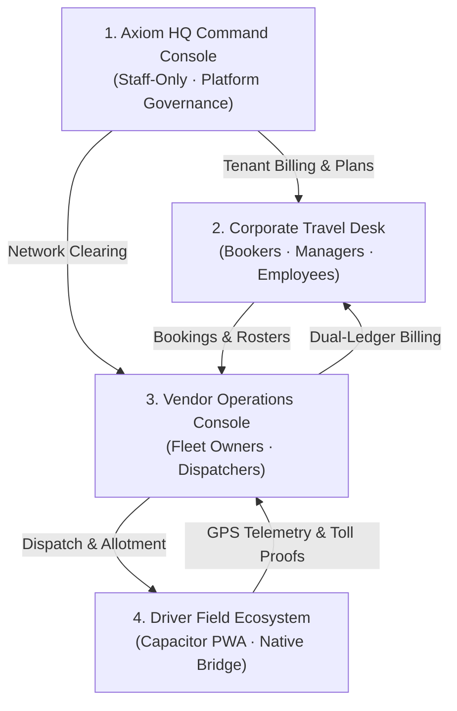

# Axiom Mobility (Fleetline) · Enterprise B2B Mobility Platform

**Axiom Mobility** is a mission-critical, enterprise B2B car rental and employee transport operating platform. It unifies corporate travel desks, associate fleet vendors, driver mobile execution, and partner network clearing houses into a hardened sovereign runtime.

Axiom Mobility is architected to match and surpass the combined industry "Tri-Stack" benchmark:
1. **Enterprise ETMS Benchmark**: Enterprise Employee Transport Management (ETMS), vehicle routing, and statutory night-shift women's safety compliance.
2. **Dynamic Dispatch & SLA Benchmark**: Multi-vendor SLA governance, automated tier demotion, penalty debit notes, and dynamic fleet dispatch.
3. **B2B Rental ERP & Dual-Ledger Benchmark**: B2B spot/contract rental ERP, dual-ledger accounting (Client Receivable vs. Supplier Payable), 3-way distance anti-fraud reconciliation, and Tally Prime XML / GST e-Invoicing.

---

## 🏛️ System Architecture: The Four Autonomous Pillars

The platform enforces strict role and boundary separation across four dedicated operational pillars:



1. **Axiom HQ Command Console (`#axiom-hq`)**:
   - Accessible exclusively to authenticated Axiom employees (`@axiomfleet.in` / `axiom_admin`).
   - Subscription billing automation, custom corporate plan controls, platform telemetry, and network clearing house.
2. **Corporate Travel Desk (`#overview` / Corporate Scope)**:
   - Multi-tier approval workflows, cost-center budget caps, employee roster management, book-for-others portal, and real-time passenger ride tracking.
3. **Vendor Operations Console (`#duties`, `#planning`, `#billing`)**:
   - 24/7 Dispatch board, auto-allotment optimizer, live GPS fleet map, maker-checker dual-ledger billing, and partner exchange network.
4. **Driver Field Ecosystem (`#driver` / Mobile Driver App)**:
   - Offline-capable PWA wrapped in Capacitor with background GPS tracking, native wake-lock, toll/fuel receipt capture, passenger masked calling, and SOS emergency dispatch.

---

## 🚀 Tri-Stack Core Capabilities

### 1. Unified Tariff & Auto-Slab Resolver (`tariff_engine.py`)
- **6 Production Billing Models**:
  - `HR_KM_SLAB`: Standard local spot rentals (4H/40K, 8H/80K, 12H/120K) with half-hour increment rounding.
  - `OUTSTATION_CALENDAR_DAY`: Calendar-day vs. 24-hour cycle billing with driver night allowances and minimum running guarantees (e.g., 250 km/day).
  - `RADIAL_ZONE_RING`: Fixed airport/hub point-to-point and concentric boundary ring rates.
  - `PER_SEAT_SHARED_POOL`: Corporate employee shuttle route costing prorated per passenger seat-kilometre.
  - `MONTHLY_DEDICATED_FIXED_VARIABLE`: Fixed vehicle dry/wet lease with variable excess kilometre and overtime run sheets.
  - `FUEL_INDEXED_BACK_TO_BACK`: Dynamic tariff escalations tied to base fuel price indices (e.g., ₹102/L base with ₹0.15/km delta per ₹1 fuel swing).
- **Auto-Slab Optimizer**: Automatically calculates all compatible slabs and applies the most cost-effective slab for corporate clients while preserving supplier margins.
- **Garage-to-Garage (G2G) vs. Pickup-to-Drop (P2P)**: Supports dead-mileage deadhead calculations or point-to-point metering.

### 2. Dual-Ledger Financial Safety (`tariff_engine.py` & `erp_gst_bridge.py`)
- **Zero IEEE 754 Floating-Point Math**: All financial math runs strictly in integer paise or backend `NUMERIC(14,2)` with `ROUND_HALF_UP`.
- **Dual-Ledger Margin Resolver**: Simultaneously calculates **Client Gross Receivable** and **Supplier Net Payable**.
- **Negative Margin Audit Hold**: Any duty where Supplier Payable exceeds Client Receivable automatically flags `maker_checker_audit_hold = True`, blocking billing closure until senior supervisor override.
- **GST SAC 996601 RCM Determination**: Evaluates supplier corporate status and automatically flags Reverse Charge Mechanism (RCM) applicability (5% GST without ITC paid by recipient vs. 12% forward charge with ITC).
- **Signed NIC IRP E-Invoice & QR Generation**: Generates 64-character SHA-256 Invoice Reference Numbers (IRN), signed QR payloads, and tax breakdown envelopes.
- **Tally Prime XML Export**: 1-click export of canonical `<TALLYMESSAGE>` Sales Vouchers with party ledgers, tax allocations, and bill-wise references.

### 3. Statutory Women's Safety & Live Telemetry (`safety_compliance.py`)
- **Night-Shift Escort Hard-Lock**: Enforces statutory safety rules between **8:00 PM and 6:00 AM**. If a female employee is the last passenger on a drop trip, dispatch is hard-locked until an authorized security guard is assigned.
- **3-Tier Safe-Reach Escalation Protocol**:
  - `T+0 to T+5 min`: P2 Push Notification & SMS safe-reach verification prompt to employee.
  - `T+5 to T+10 min`: P1 Automated Interactive Voice Response (IVR) phone call with DTMF keypress.
  - `T+10 min+`: P0 Critical Escalation to 24/7 Axiom Safety Command Center with GPS coordinates and supervisor dispatch alert.
- **16+ Telemetry Threat Detectors**: Real-time stream analysis detecting Mock GPS providers, overspeeding (>80 km/h), vehicle route deviation (>1.5 km off corridor), extended stationary halts (>10 min), and battery drain events.

### 4. Multi-Vendor SLA Governance & Tier Demotion (`sla_governance.py`)
- **Rolling SLA Tracking**: Continuously monitors Vendor On-Time Arrival (OTA %), vehicle clean scores, driver uniform compliance, and unannounced cancellations over rolling 7-day and 30-day windows.
- **Dynamic Tier Demotion**: Vendors falling below **92% OTA** or accumulating $\ge 3$ critical breaches in 7 days are automatically demoted from `TIER_1_PLATINUM` to `TIER_2_GOLD` or `TIER_3_SILVER` / `PROBATION`, reducing their priority in the auto-dispatch routing cascade.
- **Automated Penalty Debit Notes**: Automatically issues debit notes (`DN-2026-X`) deducted directly against supplier payables for driver no-shows (₹1,000), pickup delays $\ge 15$ min (₹500), or unauthorized vehicle swaps (₹750).

### 5. 3-Way Distance Anti-Fraud Audit (`backend_tristack.py`)
- **Triangulation Engine**: Cross-examines Odometer delta against raw GPS breadcrumb coordinates and OSRM road-snapped geometry.
- **Fraud Guardrails**: Any duty where odometer delta exceeds snapped route by **> 10%** or **> 5 km** is automatically flagged for `BILLING_AUDIT_HOLD`.
- **FASTag Toll Reconciliation**: Reconciles physical toll receipts against NETC FASTag NPCI API deductions.

### 6. Optimistic Concurrency Control (`backend_domain.py`)
- **Versioned Mutation Guard**: Every duty carries a strictly incrementing `version_id`.
- **Anti-Overwrite Protection**: When offline drivers sync back after operating in basements or cellular dead-zones, stale offline queues cannot overwrite intermediate dispatcher changes (returns `409 Conflict: Concurrent modification detected`).

---

## ⚡ Quick Start

### 1. Run the Local Sovereign Runtime
The backend runs dependency-free using Python 3.10+ standard libraries:

```bash
cd fleetline-mvp
python -X utf8 server.py
```

Open your browser at **`http://127.0.0.1:4173/`**.

### 2. Run the Verification Suites
Run the automated test harnesses:

```bash
# 1. Run the Tri-Stack Specification Test Suite (16/16 tests)
python fleetline-mvp/test_tristack_suite.py

# 2. Run the Optimistic Concurrency Control Suite (7/7 tests)
python fleetline-mvp/test_concurrency_control.py

# 3. Run the Complete 139-Check Platform Regression Suite
python fleetline-mvp/regression_check.py
```

---

## 📂 Repository Layout

```
Axiom_V3/
├── fleetline-mvp/
│   ├── server.py                        # HTTP/REST gateway & router
│   ├── backend_tristack.py              # Tri-Stack REST API endpoints & tables
│   ├── tariff_engine.py                 # 6-mode pricing & auto-slab resolver
│   ├── sla_governance.py                # SLA evaluation, tier demotion, debit notes
│   ├── safety_compliance.py             # Night-shift safety & safe-reach escalation
│   ├── erp_gst_bridge.py                # SAC 996601 RCM, NIC e-Invoice, Tally XML
│   ├── index.html                       # Sovereign zero-build ES6+ SPA console
│   ├── test_tristack_suite.py           # Tri-Stack automated test suite
│   ├── test_concurrency_control.py      # Concurrency control & OCC test suite
│   ├── regression_check.py              # 139-check system regression suite
│   ├── mobile-driver/                   # Offline PWA / Capacitor native wrapper
│   │   ├── src/                         # TypeScript driver execution contracts
│   │   └── capacitor.config.json        # Android/iOS native runtime config
│   └── supabase/
│       └── migrations/
│           ├── 20261027010000_concurrency_control.sql     # OCC migration
│           └── 20261027020000_schema_tristack_upgrade.sql # Tri-Stack Postgres schema
├── TECH_STACK.md                        # Exhaustive technical stack documentation
└── README.md                            # Master project documentation
```

---

## 🛡️ Enterprise Security & Standards

- **Row-Level Security (RLS)**: Every database table is isolated by `organization_id` with strict multi-tenant access control policies.
- **Dual-Runtime Parity**: Identical schema and business rule behavior between local SQLite development and production PostgreSQL on Supabase.
- **Immutable Audit Logging**: Every mutation, financial override, and status change is immutably timestamped with client IP, user ID, and before/after state diffs.
- **Zero-Trust Driver Boundary**: Driver devices are strictly sandboxed to operational updates (GPS crumbs, odometer proofs, duty milestone transitions) and prohibited from mutating rate cards or financial ledgers.
