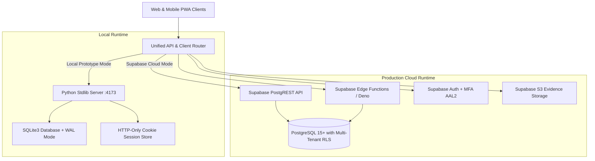

# Axiom Mobility — Technology Stack & System Architecture

This document provides a comprehensive technical breakdown of the **Axiom Mobility (Axiom Fleet)** platform, its architectural layers, dependencies, data models, and deployment targets.

---

## 1. Executive Architecture Summary

Axiom Fleet is an enterprise-grade car rental and fleet logistics operating platform engineered for multi-tenant B2B corporate travel, vendor operations, driver field execution, and network exchange clearing.

The platform follows a **Dual-Runtime Architecture**:
1. **Local / Sovereign Development Runtime**: A completely dependency-free, zero-npm Python 3 + SQLite engine for offline operations, zero-friction local development, and CI/CD deterministic smoke testing.
2. **Production Cloud Target**: A distributed Supabase platform leveraging PostgreSQL 15+, Row-Level Security (RLS) tenant isolation, PostgREST, Edge Functions (Deno), Supabase Auth with native TOTP/MFA (AAL2), and Object Storage.



---

## 2. Technology Stack by Layer

### A. Frontend & User Interface

| Component | Technology | Rationale & Specifications |
| :--- | :--- | :--- |
| **Core Architecture** | Single Page Application (SPA) | Pure Vanilla ES6+ JavaScript. Zero build steps, zero bundling latency, sub-50ms cold loads. |
| **Structure** | Semantic HTML5 | Accessible landmark roles, ARIA live regions, custom dialog modals, keyboard focus management. |
| **Styling & Design** | Vanilla CSS3 Design System | Curated design tokens, CSS Grid/Flexbox layouts, dark/light themes, glassmorphism, micro-animations. |
| **Mobile & Field Mode** | Progressive Web App (PWA) | `driver-sw.js` service worker, `driver-manifest.json`, offline app shell caching, standalone display. |
| **Offline Synchronization** | LocalStorage / IndexedDB Sync Queue | Client-side queue with cryptographic idempotency keys, FIFO replay, and optimistic UI updates. |
| **Navigation Shell** | Dual-Mode Collapsible Navigation | Full sidebar and collapsed icon rail (`Ctrl+B` / `[`), floating tooltips, animated accordion menus. |
| **Icons & Media** | Inline Scalable SVG | 100% dependency-free SVG icon sprite system with zero external font or icon CDN requests. |

---

### B. Development & Sovereign Backend (Local Runtime)

| Component | Technology | Rationale & Specifications |
| :--- | :--- | :--- |
| **HTTP Server Engine** | Python 3.10+ (`http.server`) | `ThreadingHTTPServer` from the Python standard library. Dependency-free, instant startup. |
| **Database** | SQLite 3 | Embedded database with Write-Ahead Logging (`PRAGMA journal_mode=WAL`), foreign keys, and connection concurrency locks. |
| **Session Security** | Signed HTTP-Only Cookies | `axiom_session` cookie, `SameSite=Lax`, PBKDF2-HMAC-SHA256 password hashing (180,000 iterations). |
| **Compression** | Gzip (`gzip` stdlib) | In-memory HTTP gzip stream compression for text, CSS, JavaScript, HTML, and JSON payloads. |
| **Domain Architecture** | Modular Python Slices | Clean functional separation across domain boundaries: |
| | `backend_domain.py` | Core domain: Bookings, duties, drivers, vehicles, customers, invoicing, tracking. |
| | `backend_p0.py` | Control-room foundation: Safety incidents, route plans, replacement queue, versioned masters. |
| | `backend_extended.py` | Audited CRUD, soft updates, financial maker-checker, SLA monitoring, geofences. |
| | `backend_corporate.py` | B2B Corporate travel desk: Policy evaluation, booking approval workflows, duty-slip governance. |
| | `backend_bill_intelligence.py`| Fuel and OCR bill intelligence: Supplier purchase entries, ledger postings, odometer tracking. |
| | `backend_network.py` | Axiom Network: Inter-tenant demand exchange, capability-based matching, settlement clearing. |
| | `backend_finance_controls.py` | Financial governance: Cost allocation, driver/supplier payouts, reconciliation. |
| | `backend_communications.py` | Multi-channel communication queues (SMS, WhatsApp, Email, push notifications). |

---

### C. Production Cloud Backend (Supabase / PostgreSQL)

| Component | Technology | Rationale & Specifications |
| :--- | :--- | :--- |
| **Database Engine** | PostgreSQL 15+ | Relational enterprise database with schemas, custom functions, triggers, and JSONB fields. |
| **Tenant Isolation** | Row-Level Security (RLS) | Strictly enforced tenant isolation policies ensuring tenants can never read or mutate foreign records. |
| **Migration Pipeline** | 22 Declarative SQL Migrations | Version-controlled migrations in `supabase/migrations/` covering 75+ relational domain tables. |
| **API Layer** | PostgREST | Auto-generated RESTful API with schema cache, typed filters, JSON representation headers, and RPC triggers. |
| **Serverless Logic** | Supabase Edge Functions | Deno TypeScript runtime (`functions/`) for distributed rate calculation, orchestration, and webhook verification. |
| **Identity & Access** | Supabase Auth (GoTrue) | JWT authentication, refresh token rotations, multi-factor authentication (MFA / TOTP) with native AAL2 enforcement. |
| **Object Storage** | Supabase Storage (S3-compatible) | Tenant-scoped buckets with RLS write guards for duty proof photos, signatures, inspection receipts, and fuel bills. |
| **Client Adapter** | `supabase/client.js` | Transparent browser adapter routing domain endpoints (`/api/*`) seamlessly to PostgREST, Auth, and Edge Functions. |

---

### D. Third-Party Integration Abstractions

| Interface | Abstraction Target | Supported Providers |
| :--- | :--- | :--- |
| **Payment Gateway** | Hosted checkout & Payment Links | Razorpay, Cashfree, Mock Gateway (production-neutral webhooks with HMAC-SHA256 verification). |
| **Telephony & Masked Calls**| Click-to-call & Virtual Numbers | Exotel, Twilio, Mock Telephony provider with reference tokens. |
| **Mapping & Routing** | Geocoding & Distance Matrices | Google Maps Platform, MapmyIndia, OpenStreetMap OSRM. |
| **E-Invoicing & Compliance** | GST E-Way Bill & E-Invoice | ClearTax, NIC Government Portal, Mock IRN/QR generator. |
| **Telematics & GPS** | Vehicle IoT & Fleet Telematics | Webhook GPS receiver, driver mobile tracking points, stale-signal detection. |

---

## 3. Directory Layout & Codebase Structure

```text
d:\SkynetORG\Axiom/
├── TECH_STACK.md                  # Comprehensive platform technology stack & architecture reference
├── README.md                      # Workspace entrypoint and operational guide
├── .gitignore                     # Git ignore rules (logs, SQLite databases, temp Chrome profiles)
├── .scratch/                      # Product specifications and technical PRD references
└── fleetline-mvp/                 # Main application core
    ├── index.html                 # Complete Single Page Application (UI, CSS system, state management)
    ├── server.py                  # Local Python 3 HTTP server with SQLite persistence and gzip compression
    ├── driver-sw.js               # Service Worker for Driver PWA offline shell & background sync
    ├── driver-manifest.json       # Web App Manifest for mobile home screen installation
    │
    ├── backend_*.py               # Domain backend logic modules (Python stdlib)
    │   ├── backend_domain.py      # Core operations: Bookings, duties, fleet masters, invoicing
    │   ├── backend_p0.py          # Route planning, dispatch replacements, safety incident queue
    │   ├── backend_extended.py    # Audited record versioning, SLA events, geofences, soft updates
    │   ├── backend_corporate.py   # Corporate travel desk, policy engine, approval chains
    │   ├── backend_network.py     # Network exchange, inter-fleet contracts, settlement clearing
    │   ├── backend_bill_intelligence.py # Fuel bill processing, purchase orders, odometer tracking
    │   └── backend_finance_controls.py  # Payouts, expense reconciliations, cash management
    │
    ├── supabase/                  # Production Supabase Cloud configuration & migrations
    │   ├── config.js              # Supabase connection endpoints and toggle state
    │   ├── client.js              # Full-fidelity Supabase browser adapter with RLS & RPC parity
    │   ├── config.toml            # Supabase CLI local stack configuration
    │   └── migrations/            # 22 versioned SQL migrations (75+ tables with RLS policies)
    │
    └── *_test.py                  # Automated test harness & regression verification suites
        ├── regression_check.py    # 139-check platform regression test suite
        ├── test_sidebar_menu.py   # Unit test suite for sidebar rail, collapse controls, and shortcuts
        ├── run_cdp_sidebar_test.py# Chrome DevTools Protocol (CDP) live browser test runner
        └── *_smoke_test.py        # 34 modular smoke tests verifying domain integrity
```

---

## 4. Security, Isolation & Compliance Standards

1. **Zero Unvetted Dependency Footprint**:
   The local runtime and client require **0 external npm packages** and **0 external pip libraries**. This eliminates supply-chain risks, prototype vulnerabilities, and dependency drift.
2. **Multi-Tenant Tenant Isolation**:
   Every database table contains an `organization_id` foreign key. In PostgreSQL, RLS policies guarantee tenant boundaries at the database kernel level. In SQLite, every query is bound by `organization_id = ?` parameter constraints.
3. **Session & Token Hygiene**:
   - Authentication tokens are maintained in `httpOnly`, `Secure`, `SameSite=Lax` cookies to prevent Cross-Site Scripting (XSS) extraction.
   - Passive sessions persist safely across browser tabs and page reloads until explicit sign-out.
4. **Audit Logging & Immutability**:
   Every state transition (booking creation, duty assignment, invoice issuance, driver status update) generates an immutable entry in `audit_events` with actor ID, IP address, timestamp, and field delta.
5. **Maker-Checker Financial Controls**:
   High-value payouts, supplier advances, and rate-contract revisions require multi-step approval before ledger finalization.

---

## 5. Automated Testing & Verification Gates

The platform maintains automated test coverage across three distinct validation tiers:

| Tier | Tool / Runner | Coverage |
| :--- | :--- | :--- |
| **Domain Smoke Tests** | Python standard library unittest/harness | 36 dedicated test suites covering domain logic, concurrent allocations, and pricing calculations. |
| **System Regression** | `regression_check.py` | 139 automated architectural assertions covering HTTP headers, compression, accessibility, and parity. |
| **Live Browser CDP** | Headless Google Chrome (`websockets` / CDP) | End-to-end user journeys: Authentication, Masters data entry, sidebar navigation, and mobile workflows. |
