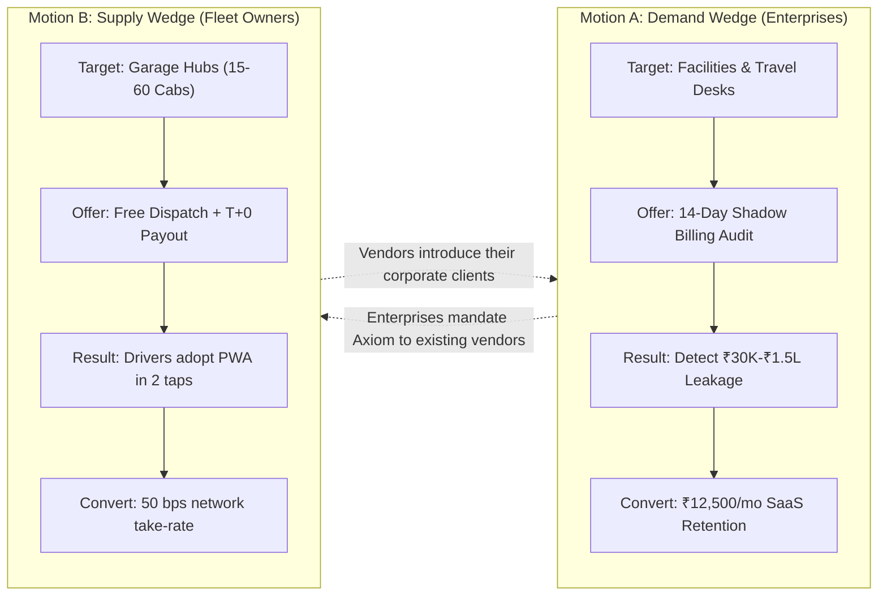

# Axiom Mobility: Dual-Wedge Execution Playbook (Enterprise Outbound + Fleet Vendor Hubs)

This playbook outlines how to execute both customer acquisition motions simultaneously from day one with 0 existing clients.

---

## 1. Dual-Wedge Architecture

---

## 2. Daily Execution Routine (Founder + AI Employees)

| Time | Responsible Desk | Execution Action | Time Required |
| :--- | :--- | :--- | :--- |
| **08:30 AM** | `chief-of-staff` | Reviews daily pipeline state and flags conversion bottlenecks | 5 min |
| **09:00 AM** | Founder + `sales-employee` | Review and send the queued first-touch drafts in `queue/` | 15 min |
| **11:00 AM** | Founder | In-person walk-ins / calls to commercial fleet garages (Vendor Wedge) | 60 min |
| **02:00 PM** | `sales-employee` | Execute follow-up sweeps on pending enterprise replies | 10 min |
| **05:00 PM** | `social-media-employee` | Publish daily LinkedIn fleet teardown post | 10 min |

---

## 3. The 14-Day Shadow-Audit Delivery Protocol (Option A)

When an enterprise admin agrees to the audit:
1. **Intake (Day 1)**: Request their previous month's vendor billing sheet (CSV/Excel) and 20 sample physical paper duty slips.
2. **Ingest (Day 2)**: Run the data through Axiom's `tariff_engine.py` and `erp_gst_bridge.py`.
3. **Audit Report Generation (Day 3)**:
   - Calculate the discrepancy between driver odometer claims vs. Google Maps route distance.
   - Highlight unverified Fastag toll additions and unapplied auto-slab optimizations.
4. **Presentation (Day 5)**: Present the 1-page **"Axiom Leakage Findings Report"**:
   > *"Last month, your vendor billed ₹8,40,000 across 520 duties. Axiom's algorithmic audit flagged ₹1,04,200 (12.4%) in unverified deadhead inflation and toll mismatches. With Axiom at ₹12,500/month, your net monthly savings will be ₹91,700."*
5. **Contract Sign-off (Day 7)**: Transition from shadow mode to active corporate workspace.

---

## 4. The Garage Hub Walk-in Protocol (Option B)

When visiting cab vendor hubs (e.g., Peenya / Udyog Vihar):
1. **Target the Owner Directly**: Ask for the garage owner or managing partner. Do not pitch software to dispatch clerks.
2. **Open with Fuel and Credit Pain**:
   > *"How much money is currently locked in 60-day client invoices, and how much cash are you advancing to drivers every morning for petrol/diesel?"*
3. **Show the Mobile PWA Live**: Hand them your phone with the driver PWA open:
   > *"Zero Play Store download. Driver taps 'Start', types customer OTP, and GPS tracks the duty. No arguments with the client over kilometers."*
4. **Close on T+0 Factoring**:
   > *"When the corporate client approves the duty, Axiom clears payment in 24 hours. You get daily cashflow, and the dispatch software is 100% free."*
