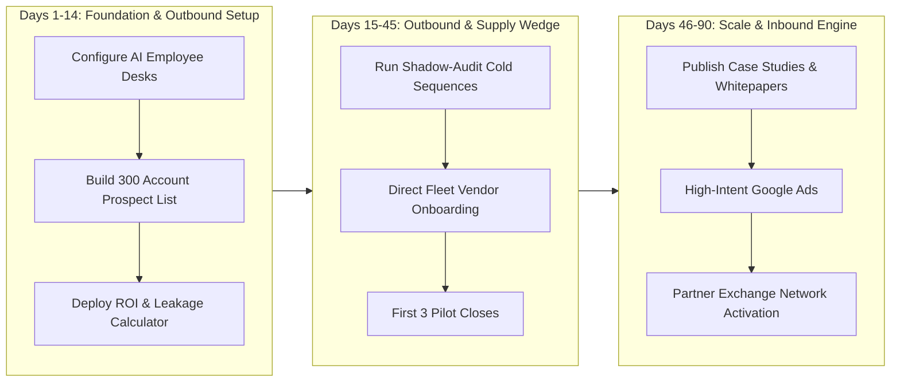

# Axiom Mobility (Fleetline): 0-to-1 Enterprise GTM & Client Acquisition Blueprint

---

## Executive Summary & Core Thesis
Axiom Mobility is an Enterprise B2B Corporate Ground Transport Operating System and Fleet Clearing Exchange. Selling enterprise transportation software from 0 clients requires bypassing traditional RFP friction. Enterprise procurement heads and administrative leads will not rip and replace existing fleet vendors for untested software.

**The Wedge Strategy: The "Shadow-Mode Leakage Audit"**
Instead of selling software, Axiom enters enterprise accounts as an **independent billing and audit layer**:
> *"Keep your existing fleet vendors. Give us 30 days of past trip sheets or run Axiom in shadow mode for 14 days. We will identify the 12% to 18% billing leakage (deadhead inflation, GPS discrepancies, and toll markups) without disrupting current operations. If we do not uncover at least 3x the subscription cost in verifiable leakage, the audit is completely free."*

---

## 1. Ideal Customer Profile (ICP) & Tiering Matrix

Based on empirical buyer simulation panel results (`founder/panel/results.md`), market viability is divided into three actionable tiers:

| Tier | Profile & Fleet Size | Decision Maker | Core Pain Point | Conversion Offer |
| :--- | :--- | :--- | :--- | :--- |
| **Tier 1: High Intent (Target First)** | Mid-Market Tech & BPO (50–500 employees, 20–80 daily cabs) | Head of Admin, Facilities Lead, VP Operations | 10-day paper duty slip reconciliation, employee night-safety compliance | 14-day Shadow-Mode Billing Audit with historical CSV import |
| **Tier 2: Supply Wedge** | Commercial Fleet Vendors (15–60 vehicles) | Fleet Owner / Managing Partner | 60–90 day payment credit cycles, daily fuel cash crunch | Free Fleet Management SaaS + T+0 Instant Invoice Factoring |
| **Tier 3: Enterprise Scale** | Large IT/Consulting Corridors (1,000+ employees, 200+ daily cabs) | VP Procurement, Chief Administrative Officer (CAO) | Statutory compliance risks, GST SAC 996601 RCM errors | Formal Security & Seam Audit Dossier + Pilot Corporate Sandbox |

> **Discard Group**: Boutique fleet operators (<10 vehicles) using WhatsApp/Excel exclusively. Conversion rate is 0% on fixed SaaS fees; engage only as sub-contracted drivers on the vendor network.

---

## 2. Multi-Channel 90-Day Execution Roadmap



### Phase 1: Cold Outbound & Account-Based Marketing (ABM) (Days 1–30)
- **Target Cities**: Bengaluru (Outer Ring Road, Whitefield, Electronic City), NCR (Gurugram CyberHub, Noida Sec 62), Hyderabad (HITEC City), Pune (Hinjawadi).
- **Weekly Volume**: 150 highly verified accounts targeted by `sales-employee`.
- **Target Roles**: Head of Corporate Services, Facilities Director, Travel Desk Lead, VP Human Resources.

#### The 3-Touch Enterprise Sequence
1. **Touch 1 (Day 1 - Cold Email/LinkedIn)**: Specific pain hook around month-end reconciliation friction and odometer tampering.
2. **Touch 2 (Day 4 - Insight & Data Proof)**: Share the 1-page benchmark report: *"How 80-cab fleets lose ₹1.4L/month on deadhead garage-to-garage math."*
3. **Touch 3 (Day 8 - Low-Friction Close)**: Offer the "No-Software Pilot" (send 1 month of anonymous trip logs for an automated discrepancy report).

---

## 3. Autonomous AI Employee Division of Labor

The 8 dedicated AI employee desks inside `employees/` execute the promotion flywheel autonomously:

```
+-----------------------------------------------------------------------------------+
|                           Chief of Staff (`chief-of-staff`)                       |
|               Daily Standup · Pipeline Governance · Metrics & KPI Review          |
+-----------------------------------------------------------------------------------+
         |                                |                               |
         v                                v                               v
+------------------+             +------------------+            +------------------+
|  Sales Employee  |             |   GTM Engineer   |            |   Social Media   |
| (`sales-employee`)|            | (`gtm-engineer`) |            | (`social-media`) |
| Lead Scraping    |             | Launch Board     |            | LinkedIn Authority|
| Account Audit    |             | ICP Calibration  |            | Industry Teardown |
| 3-Touch Outbound |             | Attribution Map  |            | Thought Leadership|
+------------------+             +------------------+            +------------------+
         |                                |                               |
         v                                v                               v
+------------------+             +------------------+            +------------------+
|   SEO Employee   |             |    Ad Manager    |            |   Web Dev Desk   |
|  (`seo-employee`)|             |  (`ad-manager`)  |            | (`web-dev`)      |
| High-Intent KWs  |             | Google Search    |            | Interactive ROI  |
| Compliance Pages |             | Retargeting      |            | Audit Landing    |
| Schema & AIO     |             | Build Sheets     |            | Demo Booking     |
+------------------+             +------------------+            +------------------+
```

### 1. `sales-employee` (Outbound Engine)
- **Daily Duty**: Sweeps corporate registries and LinkedIn Sales Navigator for facilities and procurement leads across tech corridors.
- **Deliverable**: Prepares drafts in `queue/` following strict non-templated criteria (evidence-backed triggers such as company office expansions, late-night shift hiring, or vendor dissatisfaction).

### 2. `gtm-engineer` (Conversion Architecture)
- **Daily Duty**: Maintains conversion event tracking across `#overview`, `#duties`, and booking forms.
- **Deliverable**: Maintains the unified `LAUNCH-BOARD.md`, tracking weekly conversion rates from prospect contact to audit sign-up.

### 3. `social-media-employee` (Authority & Problem Framing)
- **Daily Duty**: 3x weekly breakdowns on LinkedIn unpacking real fleet management nightmares:
  - *"Why GPS and odometer meters never match (and how corporate travel desks pay for the gap)"*
  - *"The statutory legal liabilities of Section 66 Transport Compliance for 24/7 tech operations"*
  - *"Why fleet vendors wait 60 days for payment while drivers demand daily fuel advances"*

### 4. `seo-employee` (High-Intent Organic Discovery)
- **Keywords**: "Corporate employee transport management software India", "B2B cab billing reconciliation automation", "ETMS night shift women safety compliance", "G2G odometer fraud prevention".
- **Asset**: "The 2026 Corporate Fleet Leakage Benchmark Report".

### 5. `ad-manager-employee` (Intent Capture)
- **Google Search Strategy**: Target high-commercial search phrases:
  - `[corporate cab vendor management software]`
  - `[employee transport billing software]`
  - `[b2b fleet dispatch erp]`
- **Budget Guardrail**: Build sheets only. Human founder approves spend and manually sets daily budget caps.

---

## 4. Supply-Side Wedge: The Fleet Vendor Strategy

Enterprises will not adopt without fleet supply; fleet vendors will not buy SaaS without trips. Solve this chicken-and-egg dilemma with a targeted Vendor Wedge:

1. **Target Commercial Fleet Vendors Directly (15–60 cabs)**:
   - Walk into the major cab garage hubs in Bengaluru (Koramangala, Peenya, Airport corridor), Gurugram (Udyog Vihar), and Mumbai (Andheri East).
2. **The Offer**:
   - Provide the Axiom Dispatch Board and Driver PWA **100% free of charge**.
   - Solve their primary operational friction: Instant, automated GST-compliant invoicing and **T+0 invoice factoring** (eliminating the need to wait 60 days for corporate client clearance).
3. **The Lock-In**:
   - Once 10 vendors run their drivers on the Axiom PWA, Axiom approaches mid-market enterprises already contracted with those vendors: *"Your primary vendors already run on Axiom. Turn on your Corporate Desk portal to instantly automate duty approvals and eliminate paper billing."*

---

## 5. Sales Enablement & Collateral Kit

### A. The 60-Second Elevator Pitch
> *"Every month, companies running employee and executive transport lose 15% of their fleet budget to untracked deadhead kilometers, toll inflation, and manual billing reconciliation. Axiom Mobility replaces manual paper duty slips with real-time GPS telemetry audits and dual-ledger GST billing. We run parallel to your existing fleet suppliers with zero operational friction. If we don't save you at least 3x our fee in month one, you pay nothing."*

### B. High-Converting Objection Handling Matrix

| Common Objection | Root Hesitation | Axiom Battle-Tested Counter |
| :--- | :--- | :--- |
| **"We already have vendor contracts in place for the year."** | Fear of operational disruption & switching costs | *"We do not replace your cab vendors. We give you an independent audit console that validates their trips in real-time so your accounts team stops spending 10 days reconciling paper slips."* |
| **"Our Google Sheets setup is free."** | Software cost skepticism | *"Google Sheets doesn't catch the 12% discrepancy between GPS route distance and driver odometer entries. On a ₹10 Lakh monthly bill, that free sheet costs you ₹1,20,000 in unverified leakage."* |
| **"Drivers will refuse to use another complicated app."** | Driver tech literacy concerns | *"Axiom runs as a zero-install PWA with native language support. Drivers only tap 'Start Duty' and 'End Duty' with OTP verification. No app-store downloads, no training needed."* |
| **"What if cellular network drops in basement parking?"** | Reliability in signal dead zones | *"Axiom's PWA caches GPS telemetry and timestamps in local offline storage and automatically syncs the moment signal restores, ensuring zero data loss."* |

---

## 6. Financial Feasibility & CAC Target Economics

From `founder/numbers.json` and `founder/cfo.md`:
- **Base Plan Subscription**: ₹12,500/month per corporate workspace.
- **Gross Contribution Margin**: 87% (₹10,850 contribution per client-month).
- **Fixed Monthly Burn**: ₹2,25,000.
- **Break-Even Target**: 21 active corporate accounts (achieved within 4 to 5 months under a 1 client/day target ramp).
- **Target Customer Acquisition Cost (CAC)**: < ₹15,000 per closed account (recovered in month 2).

---

## 7. Immediate 14-Day Action Checklist

- [ ] **Day 1–2**: Deploy interactive Corporate Fleet Leakage Calculator on `index.html`.
- [ ] **Day 3–5**: Run `gtm-icp-refresh` and extract top 100 enterprise facility heads in Bengaluru and NCR.
- [ ] **Day 6–8**: Dispatch first batch of 50 customized "Shadow-Mode Audit" invitations.
- [ ] **Day 9–11**: Conduct in-person walkthroughs with 5 mid-size commercial fleet operators in local tech corridors.
- [ ] **Day 12–14**: Review initial reply telemetry with `sales-pipeline-review` and secure first 2 pilot audit agreements.
